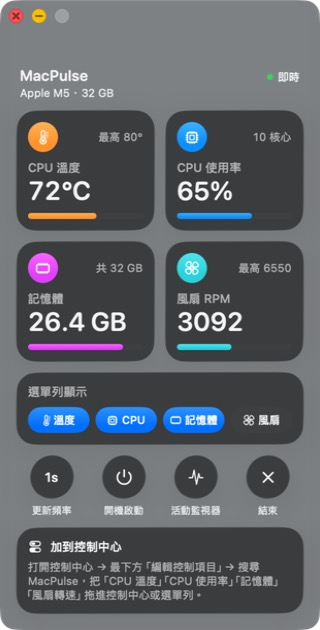
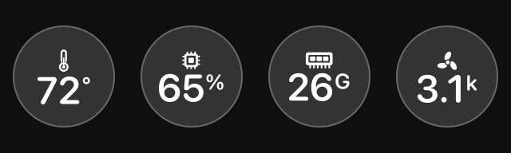
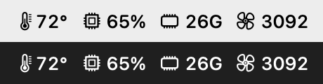

# MacPulse

在 macOS 控制中心與選單列直接看 **CPU 溫度、CPU 使用率、記憶體、風扇轉速** 的小工具。

A tiny system monitor that puts CPU temperature, CPU usage, memory and fan speed right into macOS 26 Control Center and the menu bar.

<p align="center">
  
</p>

| 控制中心控制項（1×1 也看得到數字） | 選單列 |
| --- | --- |
|  |  |

## 功能

- **控制中心控制項**：「CPU 溫度」「CPU 使用率」「記憶體」「風扇轉速」四個控制項。macOS 的 1×1 控制項只畫圖示不顯示文字，所以數字直接做成自訂 SF Symbol（例如 `74°`、`42%`、`26G`、`3.0k`），放在控制中心或拖到選單列都看得到。
- **選單列**：`🌡72° ▢65% ▭26G ✣3092`，四項可各自開關，自動配合深色／淺色選單列。
- **面板**：仿 macOS 26 控制中心的玻璃模組，溫度依高低變色（< 70°C 綠、70–84°C 橘、≥ 85°C 紅），可切換更新頻率（1／2／5／10 秒）、開機啟動。
- 輕量：背景執行不到 1% CPU。

## 需求

- macOS 26 Tahoe 以上（控制中心第三方控制項從 macOS 26 開始支援）
- Apple Silicon（CPU 溫度讀的是 Apple Silicon 的感測器；風扇轉速 Intel 也讀得到）
- Xcode 26、[XcodeGen](https://github.com/yonaskolb/XcodeGen)（`brew install xcodegen`）
- 一組 **Apple Development** 簽章憑證（在 Xcode → Settings → Accounts 登入 Apple ID 取得）與它的 Team ID

## 建置與安裝

```bash
git clone https://github.com/wohenshuai26-dev/MacPulse.git
cd MacPulse
cp Config/Local.xcconfig.example Config/Local.xcconfig
# 編輯 Config/Local.xcconfig，填入你的 DEVELOPMENT_TEAM 和 MP_BUNDLE_PREFIX
./build.sh
```

`build.sh` 會產生控制項用的數字符號、用 XcodeGen 產生 Xcode 專案、以 Release 編譯，然後安裝到 `/Applications/MacPulse.app` 並啟動。想用 Xcode 開發的話，執行 `xcodegen generate` 後打開 `MacPulse.xcodeproj` 即可。

## 加到控制中心

1. 點選單列右上角的「控制中心」圖示
2. 拉到最下方點「編輯控制項目」
3. 搜尋「MacPulse」，把想要的控制項拖進控制中心，或直接拖到選單列

控制項的數字由 MacPulse 在背景產生，建議在面板開啟「開機啟動」。MacPulse 沒在執行時，控制項會換回一般圖示。

## 運作原理

```
MacPulse.app（背景、選單列）                     控制中心
 ├─ Sampler：每 1–10 秒取樣                        ▲
 │   ├─ CPU 溫度：IOHIDEventSystem「PMU tdie*」     │ 打開控制中心時
 │   ├─ 風扇：AppleSMC F0Ac / F0Mx                  │ 系統呼叫 currentValue()
 │   └─ CPU / 記憶體：host_statistics(64)           │
 ├─ 寫入 App Group：snapshot.json ───────────► MacPulseControls.appex
 └─ ControlCenter.shared.reloadAllControls()      （ControlWidget × 4）
```

- **感測器**：CPU 溫度取 Apple Silicon 晶片上所有「PMU tdie」感測器的平均（面板另外顯示最高值），走的是 IOKit 的非公開 HID API，跟 Stats、iStat Menus 同一種做法。風扇從 SMC 讀取，不需要管理員權限。
- **資料共享**：App 跟控制項擴充功能透過 App Group 容器裡的一個 JSON 檔共享資料。macOS 上「Team ID 開頭」的 App Group 不需要描述檔，所以用 Apple Development 憑證就能簽。
- **更新時機**：App 在顯示的數字變動時請系統重新載入控制項。系統只在控制中心打開（或控制項放在選單列）時才真的去讀，打開期間大約每 1–2 秒更新一次。
- **數字符號**：`tools/make_symbols.swift` 用 CoreText 把數字轉成向量外框，搭配手繪的小圖示，輸出成 SF Symbol 範本（共 515 個），由 XcodeGen 的 `preGenCommand` 自動產生。

## 專案結構

| 路徑 | 內容 |
| --- | --- |
| `App/` | 主程式：取樣（`Sampler.swift`）、感測器（`MPSensors.c`）、面板與選單列（`MacPulseApp.swift`） |
| `Controls/` | 控制中心擴充功能（`MacPulseControls.swift`） |
| `Shared/` | 兩邊共用的資料模型與「打開面板」的 App Intent |
| `tools/` | 產生數字符號與 App 圖示的腳本 |
| `Config/` | 建置設定；`Local.xcconfig` 放你自己的 Team ID（不會進 git） |

## 限制

- 用到非公開 API（溫度感測器、SMC），無法上架 Mac App Store。
- 只在 Apple M5 MacBook Pro（macOS 26.2）上測試過；其他晶片的溫度感測器名稱可能不同；程式有針對 M1（`MTR Temp Sensor`）的備援，但沒實測過。
- 控制項只在控制中心顯示時更新，這是系統行為。

## 授權

[MIT](LICENSE)
